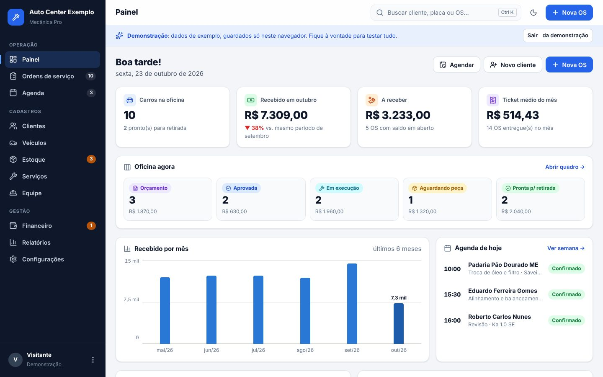
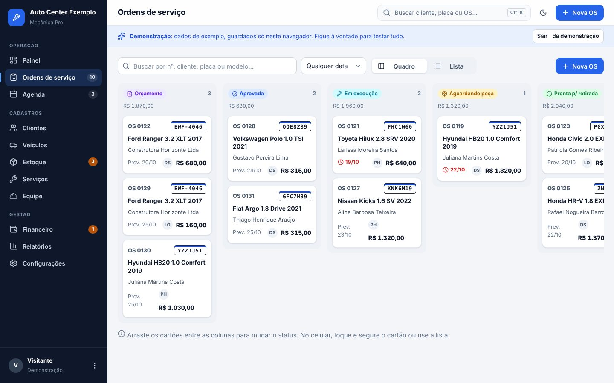
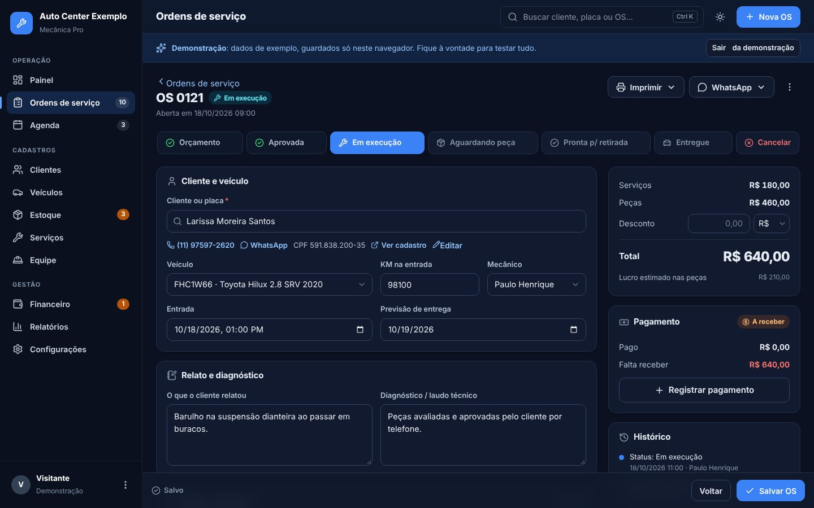
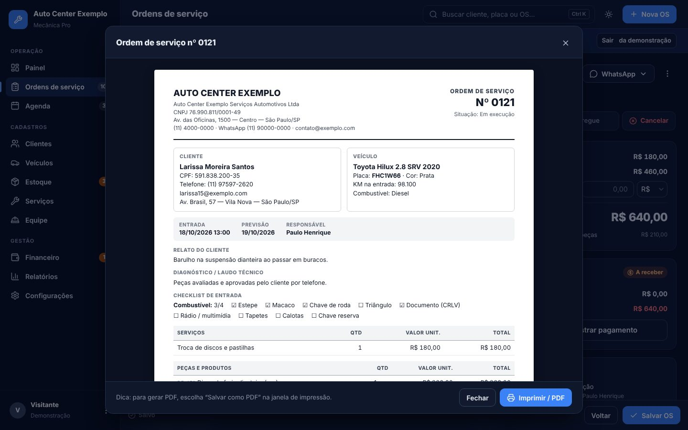
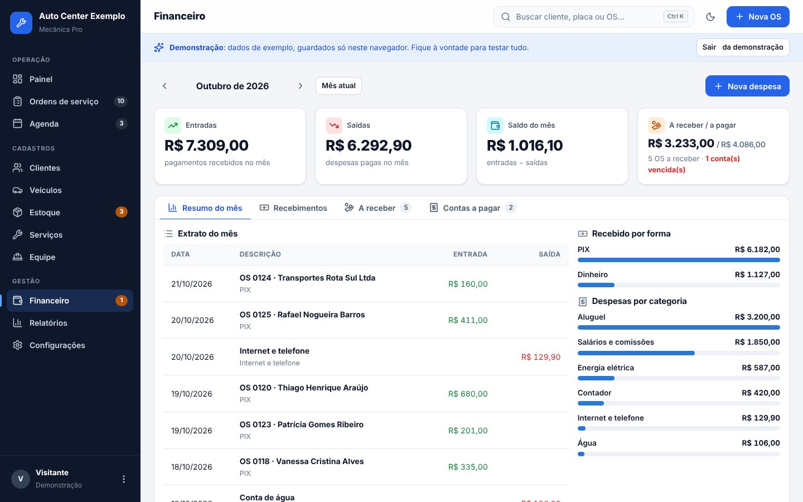

# 🔧 Mecânica Pro — sistema para oficinas mecânicas

Sistema completo e simples de usar para a rotina de uma oficina: **ordens de serviço, orçamentos, clientes, veículos,
estoque, agenda, financeiro, relatórios e WhatsApp** — no computador, no tablet e no celular.



> **Quer só olhar?** Abra o sistema e clique em **“Conhecer o sistema com dados de exemplo”**.
> A demonstração usa dados fictícios e fica guardada só no seu navegador.

---

## O que o sistema faz

| Área | O que tem |
|---|---|
| **Painel** | Carros na oficina, recebido no mês, a receber, ticket médio, gráfico dos últimos 6 meses, agenda do dia, alertas (OS atrasadas, orçamentos parados, contas vencendo, estoque baixo) e **lembretes de revisão** para avisar o cliente. |
| **Ordens de serviço** | Quadro estilo *kanban* (arrastar entre colunas) ou lista com filtros. Status: Orçamento → Aprovada → Em execução → Aguardando peça → Pronta → Entregue (ou Cancelada). Busca por **placa** ou cliente, cadastro rápido de cliente/veículo, itens do catálogo, desconto em R$ ou %, checklist de entrada (combustível, itens, avarias), laudo, garantia, próxima revisão, pagamentos parciais e histórico. |
| **Impressão / PDF** | OS completa, orçamento (com validade e campo de aprovação) e **recibo com valor por extenso**, com a logo e os dados da oficina. |
| **WhatsApp** | Mensagens prontas (e editáveis) para enviar orçamento, avisar que o carro está pronto, cobrar, lembrar revisão e confirmar agendamento. Você confere o texto antes de enviar. |
| **Clientes e veículos** | Pessoa física ou empresa, CPF/CNPJ validado, endereço com busca de CEP, vários veículos por cliente, histórico de serviços por placa, quanto cada cliente já gastou e quanto deve. |
| **Estoque** | Peças com custo, preço, margem, estoque mínimo e localização. **As peças saem do estoque sozinhas quando a OS fica pronta** (e voltam se a OS for cancelada). Entrada de nota (com opção de lançar a despesa), ajuste de inventário e histórico de movimentações. |
| **Serviços** | Tabela de mão de obra com preço e tempo; lista pronta com 19 serviços comuns; reajuste de preços em lote. |
| **Agenda** | Semana com os agendamentos, confirmação pelo WhatsApp e “Abrir OS” direto do horário. |
| **Financeiro** | Entradas (pagamentos das OS), contas a receber, contas a pagar (com repetição mensal), extrato do mês e resumo por forma de pagamento e categoria. |
| **Relatórios** | Faturado, recebido, ticket médio, lucro bruto, serviços e peças mais vendidos, **comissão por mecânico**, melhores clientes. Imprime e exporta para Excel. |
| **Equipe e acessos** | Cadastro de mecânicos (com comissão). Login individual para cada pessoa com perfis: **Dono**, **Atendente** e **Mecânico** (mecânico não vê o financeiro). |
| **Outros** | Tema claro/escuro, busca global (**Ctrl+K**), funciona sem internet (as alterações sobem quando a conexão volta), pode ser instalado como aplicativo no celular e no computador, backup em arquivo e planilhas. |

<p align="center">
  
  
</p>
<p align="center">
  
  
</p>
<p align="center"></p>

---

## Colocar no ar (passo a passo)

O sistema é um site estático (HTML, CSS e JavaScript, **sem build**). Os dados ficam no **Firebase** (Google),
no projeto `mecanicapro-11853` que já estava configurado.

### 1. Configurar o Firebase (uma vez só)

No [Console do Firebase](https://console.firebase.google.com/), projeto **mecanicapro-11853**:

1. **Authentication → Sign-in method**: deixe **E-mail/senha** ativado.
2. **Firestore Database**: crie o banco (se ainda não existir), em modo de produção.
3. **Firestore Database → Regras**: apague o que estiver lá, cole todo o conteúdo do arquivo
   [`firestore.rules`](firestore.rules) e clique em **Publicar**.
   ⚠️ **Este passo é obrigatório.** Sem ele o sistema não consegue ler/gravar (ou, pior, os dados ficam abertos).
4. **Authentication → Settings → Authorized domains**: adicione o endereço onde o site vai ficar
   (ex.: `mecanica-pro.netlify.app`).

### 2. Publicar o site

Escolha **um** dos caminhos:

- **Netlify (recomendado):** em [app.netlify.com](https://app.netlify.com/start), clique em *Import from Git*,
  escolha este repositório e a branch **`main`**. O arquivo [`netlify.toml`](netlify.toml) já diz tudo
  (pasta `app`, sem comando de build), então é só clicar em **Deploy**. Cada mudança no `main` publica sozinha.
  Também dá para arrastar a pasta `app` direto em [app.netlify.com/drop](https://app.netlify.com/drop).
- **Vercel:** importe este repositório em [vercel.com](https://vercel.com/new) e, em
  *Root Directory*, escolha a pasta **`app`**. Não precisa de comando de build. Cada mudança no `main` publica sozinha.
- **Firebase Hosting:** com o [Firebase CLI](https://firebase.google.com/docs/cli) instalado, rode na raiz do
  repositório: `firebase deploy --only hosting,firestore:rules` (já publica as regras junto).
- **GitHub Pages / qualquer hospedagem estática:** publique o conteúdo da pasta `app/`.

### 3. Primeiro acesso

1. Abra o site e vá em **Criar conta**: informe o nome da oficina, o seu nome, e-mail e senha.
2. Siga os **Primeiros passos** do painel: dados da oficina e logo, tabela de serviços (dá para carregar a lista
   pronta), mecânicos, primeiro cliente e primeira OS.
3. Para dar acesso a funcionários: **Configurações → Usuários e acessos → Convidar pessoa**. A pessoa abre o site,
   clica em **Criar conta** com o mesmo e-mail do convite e já entra na sua oficina, com o perfil escolhido.

> Quer que só convidados consigam criar conta? Em [`app/js/firebase-config.js`](app/js/firebase-config.js),
> troque `PERMITIR_NOVAS_OFICINAS` para `false`.

### Dados da versão anterior

Quem já usava a primeira versão (com OS e clientes cadastrados) **não perde nada**: no primeiro login do dono,
o sistema copia automaticamente os clientes e as OS antigas para o formato novo (criando também os veículos) e
avisa na tela quantos registros foram trazidos. Os dados antigos não são apagados.

### Backup

Os dados ficam na nuvem do Google, mas é bom ter uma cópia: **Configurações → Backup e planilhas → Baixar backup**
gera um arquivo com tudo. O mesmo lugar permite restaurar um backup (somente o dono).

---

## Perfis de acesso

| Perfil | Pode |
|---|---|
| **Dono / administrador** | Tudo, inclusive convidar/remover pessoas e restaurar backup. |
| **Atendente / gerente** | Tudo, menos gerenciar usuários e restaurar backup. |
| **Mecânico** | Ordens de serviço, agenda, clientes, veículos, estoque e serviços. Não vê financeiro, relatórios nem configurações da oficina. |

As permissões também são garantidas pelas regras do banco (`firestore.rules`), não só pela tela.

---

## Para quem for mexer no código

```
app/                    ← o site (é isso que vai para o ar)
  index.html            página única; carrega js/app.js
  css/app.css           visual (tema claro e escuro por variáveis)
  css/impressao.css     documentos impressos (OS, orçamento, recibo, relatórios)
  js/app.js             início, tela de entrada, menu, navegação (#/rota)
  js/store.js           dados em memória + adaptador do navegador (demonstração)
  js/nuvem.js           Firebase: login, banco, convites, migração da versão antiga
  js/dominio.js         regras da oficina (salvar OS, estoque, alertas, lembretes)
  js/utils.js           funções puras (dinheiro, datas, CPF/CNPJ, placa, cálculo da OS…)
  js/ui.js              janelas, avisos, campos, seletor com busca, HTML seguro
  js/formularios.js     formulários (cliente, veículo, peça, despesa, agendamento…)
  js/impressao.js       documentos para imprimir/PDF
  js/mensagens.js       mensagens de WhatsApp
  js/views/*.js         uma tela por arquivo
  sw.js                 funciona sem internet / instalar como app
firestore.rules         regras de segurança do banco
tests/                  testes automáticos
```

- Sem framework e sem build: os arquivos são servidos como estão (módulos ES).
- Todo texto digitado passa pela função `html` (template string) de `ui.js`, que escapa o conteúdo (proteção contra XSS).
- Arquivo novo em `app/`? Inclua na lista `ARQUIVOS` do `app/sw.js` e aumente a `VERSAO` (lá e em `VERSAO_APP`,
  no `app/js/app.js`). O teste `tests/unit/dados.test.mjs` avisa se esquecer.

### Rodar e testar no computador

```bash
cd tests
npm ci
npx playwright install chromium   # só na primeira vez
npm run servidor                  # abre o sistema em http://127.0.0.1:4173 (use ?demo para a demonstração)
npm run lint                      # verificação do código (Biome)
npm test                          # testes das funções + telas (computador e celular)
npm run e2e:nuvem                 # login, convites, regras e migração com os emuladores do Firebase (precisa de Java)
```

Os testes também rodam sozinhos no GitHub a cada mudança (aba **Actions → Testes**).

---

Ícones: [Lucide](https://lucide.dev) (licença ISC).
